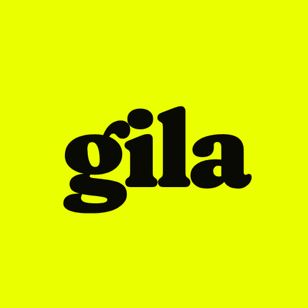

# Gila Hub · Life together, sorted.

**A shared home for two people's groceries, chores, plans and private lists.** It's free, private, and runs on iPhone, Android, Mac and Windows.

<p align="center"></p>

**G**uy + H**ila** = **Gila**, and גִּילָה means *joy* in Hebrew. The look follows Tasky by H3Y Lab: bold color cards, a soft serif and playful name-tag cursors.

| | |
|---|---|
| 🛒 **Shopping** | One bar adds and searches. It never creates duplicates, sorts items into aisles automatically (Hebrew and English), parses quantities like `2 milk` and `1 ק"ג עגבניות`, and suggests what to buy again. Groceries and Home stuff can be shown together or apart. **Shopping mode** keeps the screen awake, and your partner sees "Guy is shopping. Need anything?" |
| ✨ **Chores** | Two repeat types, in plain words: *every N days after it's done* and *on set days*. Tick a chore any time; it never piles up. Also: Away mode, taking turns, and ♡ thanks instead of scores. |
| 📋 **Projects** | Make as many as you like (or start from templates); each gets its own color page. Steps can hold steps, as deep as you need. Drag to reorder. Quick add understands `call mom tomorrow 6pm`, `every sun`, `@hila`, `!` and `מחר`. |
| 🔒 **Privacy** | **Ours · Mine · Only me** on every list *and* every item. "Only me" is encrypted with your personal key, so your partner's phone can't read it. |
| ⏰ **Reminders** | Notifications go through your own relay, end-to-end encrypted. |

## Use it

### 1. Deploy your hub (once, free, ~5 minutes)

Gila Hub runs on **your own free Cloudflare account**: one Worker serves the app *and* a tiny relay that only ever stores encrypted blobs. Two people use well under 1% of the free plan.

```bash
npm install
```

```bash
npx wrangler login
```

```bash
npm run deploy
```

You'll get an address like `https://gila-hub.<you>.workers.dev`.

**Prefer zero terminals?** Add `CLOUDFLARE_API_TOKEN` (use the "Edit Cloudflare Workers" token template) and `CLOUDFLARE_ACCOUNT_ID` as GitHub repository secrets. Every push to `main` then deploys automatically ([`deploy.yml`](.github/workflows/deploy.yml)).

### 2. Install it on every device

| Device | How |
|---|---|
| iPhone / iPad | Open the address in Safari → **Share** → **Add to Home Screen**. |
| Android | Open in Chrome → **Install app**. |
| Mac | Safari → **File → Add to Dock**, or Chrome → **Install**. |
| Windows | Edge or Chrome → **Install Gila Hub**. |

### 3. Pair

1. Open Gila Hub, tap **Get started**, type your name, pick a color and tap the projects you want.
2. Tap **Bring your person in** to get a one-time code.
3. On their phone, open the installed app → **I have a code**.
4. To add your own laptop, use **Settings → Add another device**.

## How it stays private

- **Local-first.** Your data lives on your devices and works fully offline. Every field syncs on its own, so two people editing at once never overwrite each other.
- **End-to-end encrypted.** Every change is sealed with AES-256-GCM before it leaves the device. The relay sees ciphertext and timestamps only. It can't read a single item, name or note.
- **"Only me" is real.** Private items use a personal key that never reaches your partner's devices.
- **No accounts, no analytics, no third parties.** Fonts are self-hosted, and the only server is yours.
- **Your data is yours.** Export and import JSON from Settings.

## Docs

The planning that came before the build:

1. [Research](docs/01-RESEARCH.md): ~40 to-do, grocery, chore and couples apps, and what they teach us.
2. [Brand](docs/02-BRAND.md): the name, the steal, the logo, the palette, the voice.
3. [Design system](docs/03-DESIGN-SYSTEM.md): "The Hub Standards Manual".
4. [Features](docs/04-FEATURES.md): every requirement mapped to features, plus what's next.
5. [Architecture](docs/05-ARCHITECTURE.md): local-first sync, encryption scopes, pairing, push.
6. [Plan](docs/06-PLAN.md): milestones, roadmap, risks.

## Develop

```bash
npm run dev           # app on :5173 (local-only mode)
```

```bash
npm run dev:worker    # relay on :8787 (in a second terminal; Vite proxies /api to it)
```

```bash
npm test              # unit tests: sync engine, privacy scopes, parsers, recurrence, RFC 8291 push crypto
```

```bash
npm run e2e           # two browsers pair and sync through a local relay
```

```bash
npm run typecheck
```

Stack: Vite, React 19 and TypeScript, with a hand-built design system and no UI framework. The sync engine is a field-level last-writer-wins replica with hybrid logical clocks. The relay is a Cloudflare Worker plus SQLite Durable Objects, and Web Push is implemented with WebCrypto only.
